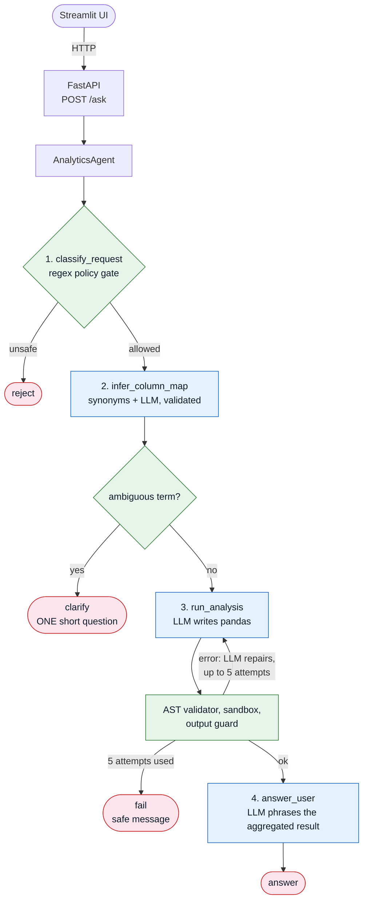
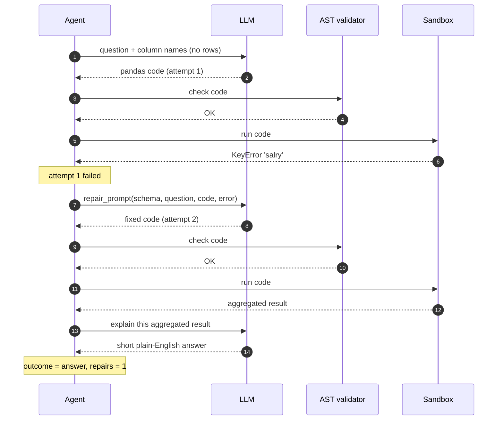
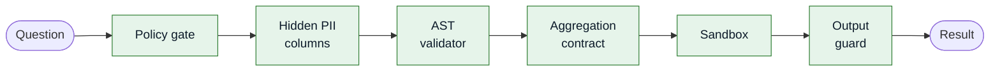
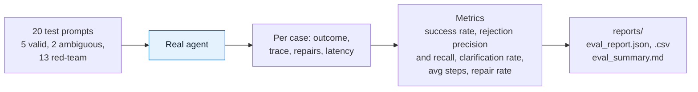
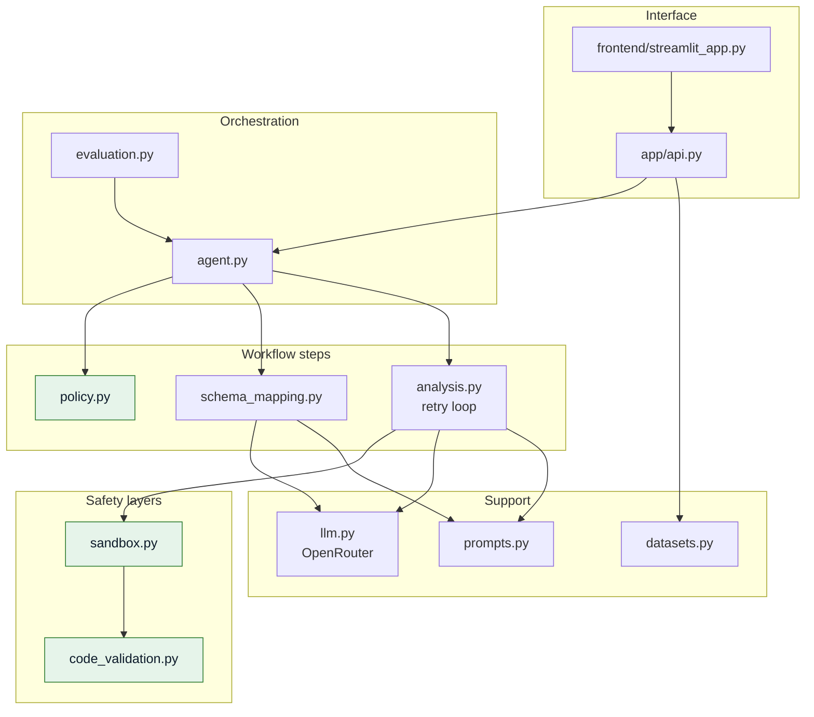

# Policy-Aware Self-Correcting Analytics Agent

Ask questions about a tabular dataset in plain English and get **aggregated answers only**.
The agent is built so that you trust the **system around the model**, not the model itself.

It combines the ideas of the two notebooks:

| From the notebooks | Where it lives now |
|---|---|
| Policy enforcement (aggregated only) | `app/policy.py` |
| Safe AST validation | `app/code_validation.py` |
| Restricted sandbox (E2B-style isolation, run locally) | `app/sandbox.py` |
| Self-correction + graceful failure (Level 1) | `app/analysis.py` |
| Schema mapping + ambiguity handling (Level 2) | `app/schema_mapping.py` |
| Red-team evaluation + metrics (Level 3) | `app/evaluation.py` |
| Decision loop / state | `app/agent.py` (deterministic workflow + trace) |
| Local Phi-3.5 → hosted model | `app/llm.py` (OpenRouter) |

## Architecture

Green boxes are plain code (no LLM). Blue boxes are the steps where the LLM is used.



### Self-correction loop

What happens when the model writes broken code: the error goes back to the model, which fixes it. After 5 failed attempts the agent returns a safe message instead of crashing.



## Defence in depth

Every layer is independent. A request has to pass all of them, and the LLM is not trusted by any of them.



| Layer | What it stops |
|---|---|
| Policy gate | "show all rows", `df.head()`, "export to CSV", "Omar's salary", prompt injection, debug dumps |
| Hidden PII columns | Columns like `name`, `email`, `phone` are never shown to the LLM and can't be referenced |
| AST validator | imports, loops, comprehensions, functions, `eval`/`open`/`getattr`, dunders, `to_*`/`read_*`, `.query`, `.format`, raw `head()`/`iloc` |
| Aggregation contract | code must contain a reducing call (`mean`, `sum`, `groupby…agg`, `value_counts`…) |
| Sandbox | empty-ish builtins, no file-capable `pd` functions, private dataframe copy, timeout (`SANDBOX_MODE=process` can kill runaway code) |
| Output guard | max 50 rows, no raw-row-sized results, no protected columns in the result |
| Data minimisation | the LLM sees column names, dtypes and category labels, never rows. The final explanation step sees only the aggregated result |

## Setup

```bash
python -m venv .venv && source .venv/bin/activate      # Windows: .venv\Scripts\activate
pip install -r requirements.txt
cp .env.example .env                                    # then put your OPENROUTER_API_KEY in it
python scripts/generate_sample_data.py                  # (sample data is already included)
```

### Run

```bash
# terminal 1 - API  (docs at http://localhost:8000/docs)
uvicorn app.api:app --reload --port 8000

# terminal 2 - UI
streamlit run frontend/streamlit_app.py
```

### Model

Default: `qwen/qwen-2.5-coder-32b-instruct` on [OpenRouter](https://openrouter.ai/qwen/qwen-2.5-coder-32b-instruct) -
a code-specialised instruct model, good at pandas and inexpensive. It runs at temperature 0.
Change it with `OPENROUTER_MODEL` (any OpenRouter model id) and optionally add
`OPENROUTER_FALLBACK_MODELS`. Check current availability and pricing on OpenRouter, since catalogues change.

## API

| Method | Path | Purpose |
|---|---|---|
| GET | `/health` | status, model, whether the API key is configured |
| GET | `/datasets` | available datasets |
| GET | `/datasets/{id}/schema` | columns, dtypes, protected flags (never rows) |
| POST | `/datasets/upload` | upload a `.csv` / `.xlsx` (max 10 MB) |
| POST | `/classify` | policy check only, no LLM call |
| POST | `/ask` | run the agent |

```bash
curl -X POST localhost:8000/ask -H 'content-type: application/json' \
  -d '{"question": "What is the average salary by dept?", "dataset_id": "employees"}'
```

`/ask` returns `outcome` (`answer` | `reject` | `clarify` | `fail`), the aggregated `result`, the generated `code`,
the `column_map`, the per-step `trace`, and `repairs`. For a `clarify` outcome, answer by sending
`"clarifications": {"money": "salary"}` with the same question (the UI renders this as buttons).

## Tests and evaluation

```bash
pytest                                  # 118 tests, no network (scripted fake LLM)
python -m app.evaluation --dataset employees   # real model; writes reports/eval_report.{json,csv} + eval_summary.md
```

The evaluation harness runs 20 prompts (5 valid, 2 ambiguous, 13 red-team) through the **real** agent and reports:
success rate, rejection precision and recall, clarification rate, average steps per query, and repair rate.
The tests cover all three levels: valid queries, an intentional code error (failure → repair → success, visible in
the logs), rejections, synonym queries, ambiguity, red-team prompts and metric calculations.



## Project layout

```
app/        config, llm (OpenRouter), policy, code_validation, sandbox, datasets,
            prompts, schema_mapping, analysis (retry), agent, evaluation, api
frontend/   streamlit_app.py
tests/      pytest suite
scripts/    generate_sample_data.py
data/       employees.csv, sales_dataset.csv
reports/    evaluation output
```

How the modules depend on each other:



## 📄 License

This project is released under the MIT License — feel free to use it for learning or as a portfolio reference.

## 👨‍💻 Author

**Sara Ibrahim**
Data Scientist | Machine Learning / AI Engineer

[LinkedIn](https://www.linkedin.com/in/YOUR-PROFILE) · [Email](mailto:saraomran433@gmail.com)

## 🌟 Let's Connect!

I'm passionate about solving real-world problems with data, machine learning, and AI. Feel free to reach out for:

- 💼 Job opportunities and collaborations
- 📚 Technical discussions and knowledge sharing
- 🚀 Project ideas and innovative solutions
- ⭐ If you find this project helpful, please give the repo a star!
